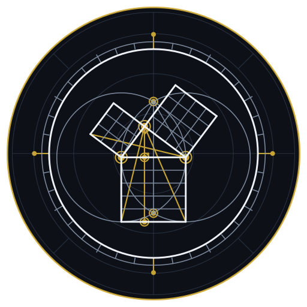

.. container:: author-overline

   semantic digital archive • mathematical catalog

=====================
Constructive Elements
=====================

The Constructive G-Index (``G.1``–``G.601``) codifies the complete logical architecture of Euclid's *Elements* into a computable directed acyclic dependency graph and exact symbolic algebra. Within the interconnected `GEOMETOR <https://geometor.com/books/>`_ semantic digital archive, every definition, postulate, common notion, and proposition is liberated into an executable unit featuring step-by-step constructive pseudocode, dynamic vector diagrams, and complete ancestral dependency trees speaking one shared geometric language.

.. reference-directory::
   :sort: order

.. toctree::
   :maxdepth: 2
   :hidden:

   about/index
   elements2/index
   people/index
   bibliography
   usage/index
   log/index
   modules/index

----

Indices
-------

* :ref:`genindex`
* :ref:`modindex`
* :ref:`search`
